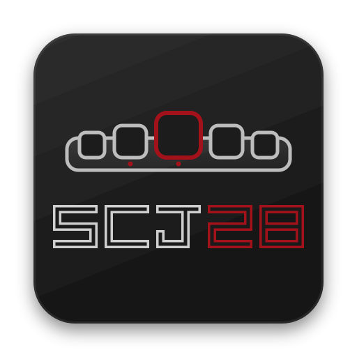
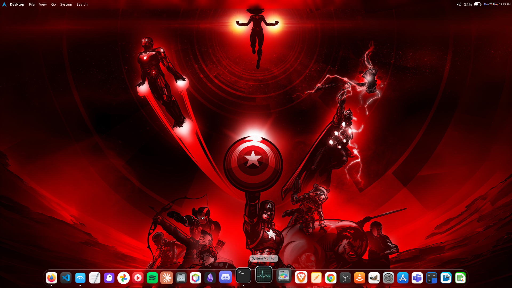
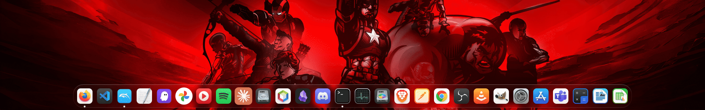

<p align="center"></p>

# Mac Dock

[](https://github.com/sidneicjr28/mac-dock/releases)
[](LICENSE)


[](https://store.kde.org/p/2382863)
[](https://quickshell.org)

A macOS-style glass dock for **KDE Plasma 6 (Wayland)**, built with [Quickshell](https://quickshell.org).





- Gaussian icon magnification on hover, launch bounce, running-app dots
- Bottom, left, right or top of the screen; optional auto-hide
- On every monitor or just one
- Drag to reorder pinned apps; drag away from the dock and release to unpin
- Separators to group pinned apps; unpinned running apps appear after a divider
- Real background blur through KWin's Glass effect (or KDE's built-in Blur), with a glass highlight rim
- Per-screen auto-scaling for lower-resolution monitors
- Super+1…9 open (or focus/cycle) the first nine apps on the dock
- Right-click menu (pin/unpin, settings) and a settings window (size, magnification, colors, blur, placement, apps)

## Requirements

| Requirement | Arch package | Used for |
|---|---|---|
| KDE Plasma 6 on Wayland | `plasma-meta` | Compositor (KWin), global shortcuts |
| [Quickshell](https://quickshell.org) | `quickshell` | Runs the dock |
| Python 3 + pywayland | `python-pywayland` | Window list bridge |
| Python D-Bus + GObject | `python-dbus`, `python-gobject` | Super+1…9 shortcuts |
| KWin [Glass](https://github.com/4v3ngR/kwin-effects-glass) effect | `kwin-effects-glass-git` (AUR) | Background blur (optional; otherwise KDE's built-in Blur is used) |

## Installation

### Easy install (recommended)

Open **Konsole** (search "Konsole" in the app menu), paste this line and press Enter:

```sh
curl -fsSL https://raw.githubusercontent.com/sidneicjr28/mac-dock/main/install.sh | bash
```

The installer:

1. Installs the required packages (asks for your password)
2. Downloads Mac Dock to `~/.local/share/mac-dock`
3. Offers to install and enable the Glass blur effect (optional, takes a few minutes)
4. Makes the dock start automatically when you log in
5. Starts the dock

Run the same line again later to **update**. Automatic package install works on Arch-based
systems (Arch, EndeavourOS, CachyOS, Manjaro). On other distros, install the
[requirements](#requirements) with your package manager first; the installer then does the rest.

Afterwards you may want to remove or auto-hide the Plasma panel (right-click it → *Show Panel Configuration*).

The dock takes over **Super+1…9** from Plasma's task manager. Rebind them under
*System Settings → Shortcuts → Mac Dock*.

### Uninstall

```sh
bash ~/.local/share/mac-dock/install.sh --uninstall
```

This stops the dock, removes it from autostart and gives Super+1…9 back to Plasma.

### Manual install

1. Install the [requirements](#requirements).
2. Clone the repository and run the installer from inside it (it uses that folder in place):

   ```sh
   git clone https://github.com/sidneicjr28/mac-dock.git
   cd mac-dock && ./install.sh
   ```

   Or skip the installer and run the dock directly with `qs -n -p /path/to/mac-dock` (`-n` refuses to start a second copy).

3. Blur: with no extra setup the dock uses KDE's built-in **Blur** effect, if it is on in
   *System Settings → Desktop Effects* (its strength is the global one set there).
   For the Glass effect without the installer, turn on **Glass** (and turn off **Blur**) in *System Settings → Desktop Effects*, then:

   ```sh
   kwriteconfig6 --file kwinrc --group Effect-blurplus --key WindowClasses quickshell
   qdbus6 org.kde.KWin /Effects org.kde.kwin.Effects.reconfigureEffect glass
   ```

   The dock window is excluded from Glass's force-blur; a separate bar-sized window carries the blur.
   The dock keeps `DockCornerRadius` and `DockBlurStrength` in sync with its own settings.

## Usage

Open settings by right-clicking the dock, left-clicking an empty part of the bar, or (use your folder if you installed elsewhere):

```sh
qs -p ~/.local/share/mac-dock ipc call dock settings
```

Settings are stored in `~/.config/mac-dock/config.json` (created on first run).

## Architecture

| Path | Responsibility |
|---|---|
| `shell.qml` | Composition root: creates services once and injects them into views |
| `services/Config.qml` | Persistent settings (`config.json`) and defaults |
| `services/AppCatalog.qml` | App id → desktop entry / icon resolution |
| `services/WindowTracker.qml` | Open windows and focus/cycle/minimize actions |
| `services/DockModel.qml` | Dock items (pinned groups + running apps) and all pin edits |
| `services/SupervisedProcess.qml` | Helper processes that restart on exit |
| `services/GlassProcess.qml` | Launches the blur window under its own window class |
| `services/KwinGlassSync.qml` | Mirrors radius/blur strength into kwinrc |
| `dock/` | Dock view: layout, input, icons, rim, tooltip, menu; `Magnify.js` holds the pure layout math |
| `settings/` | Settings window, one file per page plus reusable config-bound controls |
| `install.sh` | Installer / updater / uninstaller |
| `glass/shell.qml` | The bar-sized blur window (separate process) |
| `bridge/shortcuts.py` | Registers Super+1…9 with KDE's KGlobalAccel (releasing Plasma's task-manager bindings) and reports presses |
| `bridge/windows.py` | KWin `org_kde_plasma_window_management` → JSON bridge (KWin lacks wlr-foreign-toplevel) |

`bridge/protocols/plasma-window-management.xml` is from KDE's
[plasma-wayland-protocols](https://invent.kde.org/libraries/plasma-wayland-protocols) (LGPL-2.1-or-later);
`bridge/pwm_proto.py` is generated from it with the pywayland scanner.

## License

[MIT](LICENSE)
